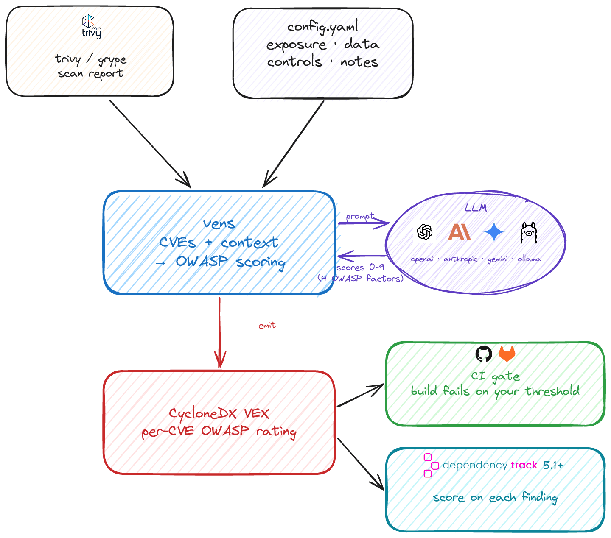

[![GitHub Release][release-img]][release]
[![CI][ci-img]][ci]
[![Go Report Card][go-report-img]][go-report]
[![License: Apache-2.0][license-img]][license]
[![GitHub Downloads][github-downloads-img]][release]
[![Documentation][docs-img]][docs]

# vens — Prioritize vulnerabilities in your system's context, not just by the generic CVSS score

**Your scanner hands you a long list of CVEs. Which ones do you review first?** Vens takes a Trivy or Grype report, combines it with a description of _your_ system (exposure, data sensitivity, compliance, security controls), and rates every CVE with OWASP Risk Rating in your context — not just by its generic severity.

The output is a [CycloneDX VEX](https://www.ntia.gov/files/ntia/publications/vex_one-page_summary.pdf) file with [OWASP Risk Rating](https://owasp.org/www-community/OWASP_Risk_Rating_Methodology) scores.
Your CI gate fails the build on it, and [Dependency-Track 5.1+](https://venslabs.github.io/vens/guides/dependency-track/) puts it on every matching finding.

<p align="center">
  
</p>

## Why vens?

OWASP Risk Rating reflects your system's exposure, data, records and controls — not just generic CVE severity. For each CVE, the LLM answers closed questions on up to 12 of the 16 OWASP factors in your context; vens computes every level, the severity from OWASP's likelihood × impact matrix, and a 0-81 score to sort CVEs within a severity:

| Scenario | CVSS base | OWASP (Contextual) | Why? |
|-----|----------------|-------------------|------|
| Denial of service in a library function your internal service never calls | 7.5 HIGH | **low** (14.1) ⬇️ | Reaching it takes full access; the CVSS vectors rule out data loss |
| Info leak in a PII handler running under GDPR | 5.3 MEDIUM | **critical** (54.4) ⬆️ | Thousands of people's data and a GDPR violation: the business impact is HIGH |

*Ratings above are illustrative — actual ratings depend on your `config.yaml` and the LLM model. Code that never runs can lower the likelihood through the model's answers, never below MEDIUM, so an unreachable RCE with a HIGH impact still rates `high` or `critical`: see [Limitations](https://venslabs.github.io/vens/concepts/limitations/).*

## Installation

**[GitHub Action](https://github.com/marketplace/actions/vens-action):**
```yaml
- uses: venslabs/vens-action@v0.2.0   # check the marketplace for the latest tag; pin by SHA in production
  with:
    version: v0.6.0                   # vens binary version
    config-file: .vens/config.yaml    # see docs/guides/configuration.md to author this file
    input-report: report.json
    sbom-serial-number: ${{ vars.SBOM_SERIAL }}
    llm-provider: openai
    llm-model: gpt-5.4-mini
    llm-api-key: ${{ secrets.OPENAI_API_KEY }}
    fail-on-severity: critical        # break the build on critical OWASP risk
```

See the [GitHub Actions guide](https://venslabs.github.io/vens/guides/github-actions/) for the full input/output reference.

**Run Vens locally:**

```bash
# Go install
go install github.com/venslabs/vens/cmd/vens@latest

# Or as a Trivy plugin (https://trivy.dev/docs/latest/plugin/)
trivy plugin install github.com/venslabs/vens
```

## Quick Example

```bash
# 1. Set up LLM (OpenAI shown — Anthropic, Google AI, or local Ollama also supported)
export OPENAI_API_KEY="sk-..."
export OPENAI_MODEL="gpt-5.4-mini"

# 2. Scan with Trivy or Grype
trivy image python:3.11-slim --format json --output report.json
# or
grype python:3.11-slim --output json --file report.json

# 3. Use your CycloneDX SBOM's serialNumber (or generate an ad-hoc UUID for this quickstart)
SBOM_SERIAL="urn:uuid:$(uuidgen | tr '[:upper:]' '[:lower:]')"

# 4. Generate contextual risk scores
vens generate --config-file config.yaml --sbom-serial-number "$SBOM_SERIAL" report.json output.vex.json

# 5. Optionally fold the OWASP ratings into a copy of the Trivy report
vens enrich --vex output.vex.json --output enriched-report.json report.json
```

Output is a [CycloneDX VEX](https://cyclonedx.org/capabilities/vex/) document; each vulnerability carries an OWASP rating:

```json
{
  "vulnerabilities": [{
    "id": "CVE-XXXX-YYYY",
    "source": { "name": "NVD", "url": "https://nvd.nist.gov/vuln/detail/CVE-XXXX-YYYY" },
    "ratings": [{
      "method": "OWASP",
      "score": 32.9375,
      "severity": "high",
      "vector": "SL:9/M:4/O:9/S:9/ED:9/EE:5/A:9/ID:8/LC:2/LI:1/LAV:7/LAC:7/FD:7/RD:5/NC:2/PV:3"
    }]
  }]
}
```

The vector holds the 16 OWASP levels; the severity and the score follow from it. The model's answers and reasoning are captured with the prompts and replies when you pass `--debug-dir <path>`, with `answers.json` giving each answer and the level vens read from it. They are intentionally not embedded in the VEX file to keep the document strictly CycloneDX-compliant. For a durable, auditable record of how each CVE was scored, pass `--attest` to also write a CycloneDX attestation next to the VEX.

## Configuration

Create `config.yaml`:

```yaml
schema_version: 2

project:
  name: "my-api"
  description: "Customer-facing REST API"

context:
  exposure: "internet"              # internal | private | internet
  data_sensitivity: "high"          # low | medium | high | critical
  business_criticality: "high"      # low | medium | high | critical
  compliance_requirements: ["GDPR", "SOC2"]
  listener: "present"               # present | absent | unknown
  data_subjects: "thousands"        # none | one_individual | hundreds | thousands | millions
  detection:                        # not_logged | logged | logged_and_reviewed
    network: "logged"
    host: "not_logged"
    application: "logged_and_reviewed"
  traceability: "per_request"       # none | per_request | per_individual
  controls:
    waf: true
```

Leave out `data_subjects`, `detection` or `traceability` and vens warns at load and uses that field's fallback: no cap on Privacy violation, Intrusion detection at 9 on every finding, or Loss of accountability from its `none` column. Every field is in the [config.yaml reference](https://venslabs.github.io/vens/reference/config-schema/); a file written for vens v0.6 needs the [migration](https://venslabs.github.io/vens/reference/config-schema/#migrating).

**LLM Providers:**

| Provider | Environment Variable |
|----------|---------------------|
| OpenAI (recommended) | `OPENAI_API_KEY` |
| Anthropic | `ANTHROPIC_API_KEY` |
| Ollama (local) | `OLLAMA_MODEL` |
| Google AI | `GOOGLE_API_KEY` |

## Command Reference

### `vens generate`

Generate VEX with contextual OWASP scores:

```bash
vens generate --config-file config.yaml --sbom-serial-number urn:uuid:<uuid> INPUT OUTPUT
```

**Supported scanners:**
- ✅ **Trivy** - Auto-detected from JSON report format
- ✅ **Grype** - Auto-detected from JSON report format

**Key flags:**
- `--config-file` (required) - Path to config.yaml
- `--sbom-serial-number` (required) - serialNumber of the CycloneDX SBOM paired with this scan, in `urn:uuid:<uuid>` form (`jq -r .serialNumber sbom.cdx.json`)
- `--input-format` - Scanner format: `auto` | `trivy` | `grype` (default: `auto`)
- `--llm` - LLM provider: `openai` | `anthropic` | `ollama` | `googleai` (default: `auto`)
- `--llm-batch-size` - Distinct CVEs per batch; each batch makes one call per question (default: `10`)
- `--strict` - Fail the run instead of using a worst-case fallback
- `--debug-dir` - Save prompts, responses and `answers.json` for debugging
- `--cyclonedx-spec-version` - CycloneDX spec version for the VEX output: `1.6` | `1.7` (default: `1.6`, which released Dependency-Track versions can ingest; opt up to `1.7` if your consumer supports it)
- `--attest` - Emit a CycloneDX attestation sidecar recording how each CVE was scored (model, seed, prompt/input/config hashes, reasoning, raw response) for audit and reproduction

### `vens enrich`

Copy the OWASP scores from a VEX into a Trivy report:

```bash
vens enrich --vex output.vex.json --output enriched-report.json report.json
```

**Key flags:**
- `--vex` (required) - Path to the VEX file written by `vens generate`
- `--output` - Where to write the enriched report (default: stdout)

---

## Learn More

- **[📖 Full Documentation](https://venslabs.github.io/vens/)** — installation, guides, reference
- **[5-minute Quickstart](https://venslabs.github.io/vens/getting-started/quickstart/)** — your first VEX
- **[Prioritize a CVE backlog](https://venslabs.github.io/vens/guides/prioritize-cves/)** — the main use case
- **[CVSS vs OWASP contextual](https://venslabs.github.io/vens/concepts/cvss-vs-owasp/)** — why the scores move
- **[Choosing an LLM](https://venslabs.github.io/vens/concepts/choosing-a-model/)** — which model to run, with a [benchmark](https://venslabs.github.io/vens/assets/vens-benchmark.pdf) run on the scoring up to v0.6
- [Complete Example](examples/quickstart/) - 107 real CVEs comparison
- [Trivy Plugin Guide](docs/TRIVY_PLUGIN.md) - Plugin usage

## Contributing

Contributions are welcome. See **[CONTRIBUTING.md](CONTRIBUTING.md)** for the full contributor guide: development setup, coding standards, testing with the mock LLM, commit conventions, and the review process.

Quick start for contributors:

- **Good first issue?** Look for the [`good first issue`](https://github.com/venslabs/vens/issues?q=is%3Aissue+is%3Aopen+label%3A%22good+first+issue%22) label.
- **Bug report?** Open an issue with the exact command, your `vens --version`, and (if possible) redacted `--debug-dir` output.
- **Bigger change?** Open an issue first so we can agree on scope before you write the code.
- **Security report?** See [SECURITY.md](SECURITY.md) — please do not open public issues for vulnerabilities.

## License

Apache License 2.0 - See [LICENSE](LICENSE)

---

**Rank CVEs in your context, not by CVSS alone.**

[docs-img]: https://img.shields.io/badge/docs-venslabs.github.io%2Fvens-blue?logo=readthedocs&logoColor=white
[docs]: https://venslabs.github.io/vens/
[release-img]: https://img.shields.io/github/release/venslabs/vens.svg?logo=github
[release]: https://github.com/venslabs/vens/releases
[ci-img]: https://github.com/venslabs/vens/actions/workflows/main.yml/badge.svg
[ci]: https://github.com/venslabs/vens/actions/workflows/main.yml
[go-report-img]: https://goreportcard.com/badge/github.com/venslabs/vens
[go-report]: https://goreportcard.com/report/github.com/venslabs/vens
[license-img]: https://img.shields.io/badge/License-Apache%202.0-blue.svg
[license]: https://github.com/venslabs/vens/blob/main/LICENSE
[github-downloads-img]: https://img.shields.io/github/downloads/venslabs/vens/total?logo=github
